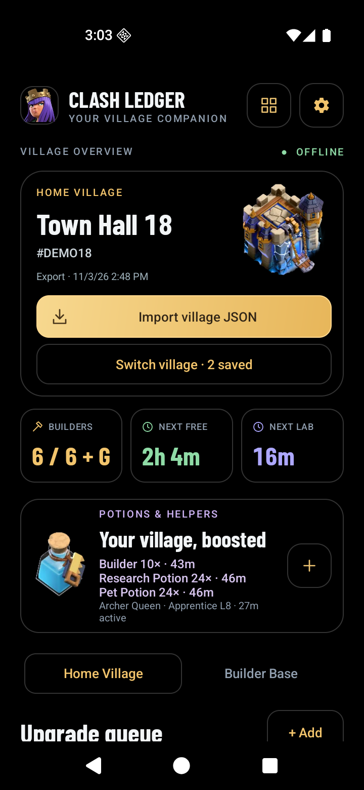
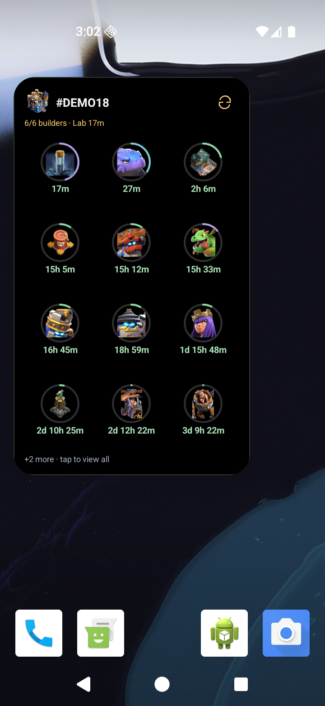
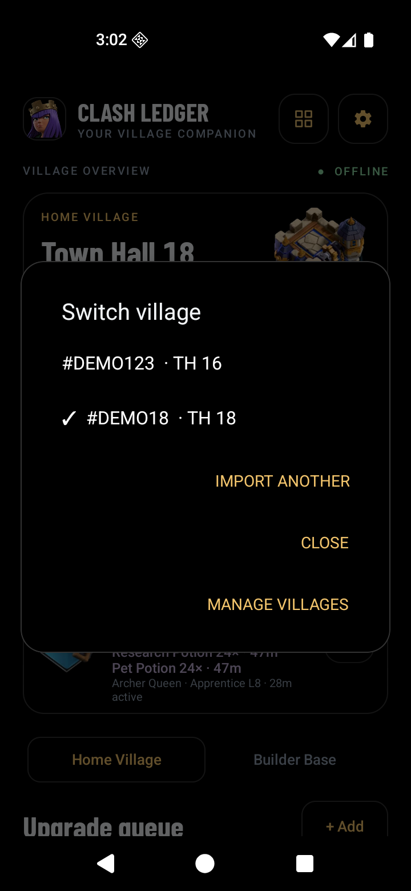
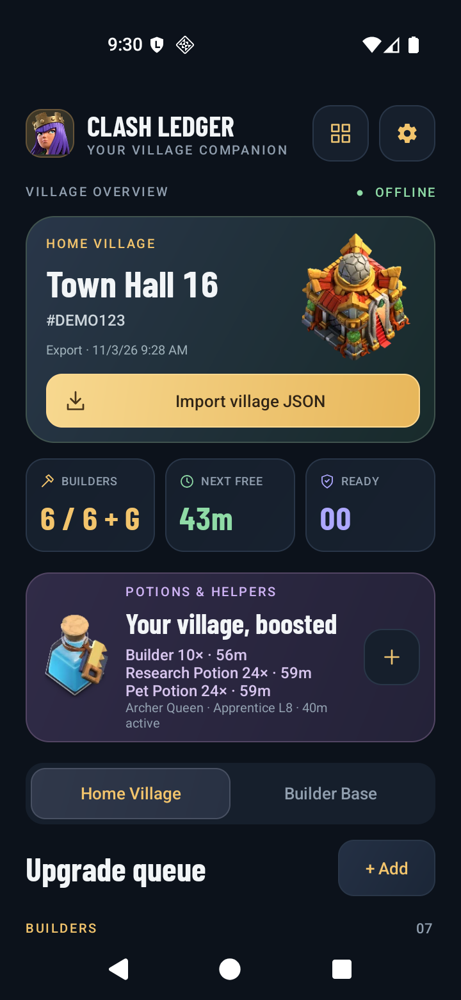
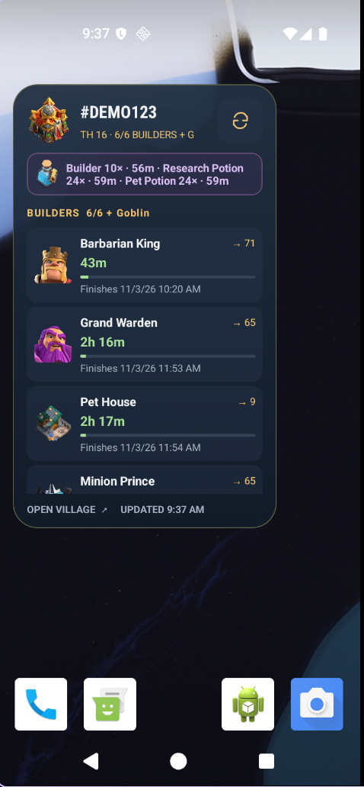
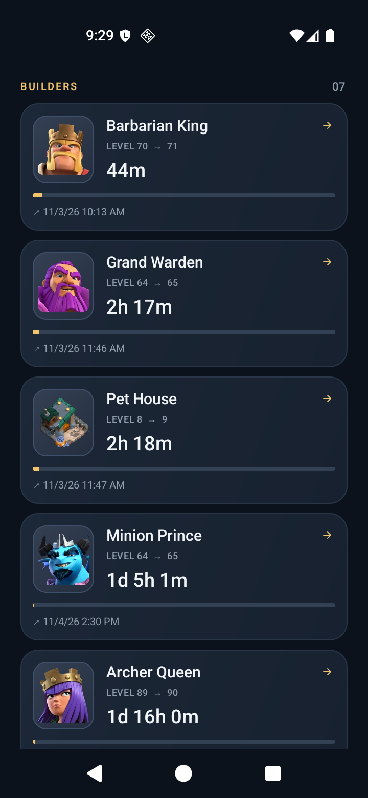
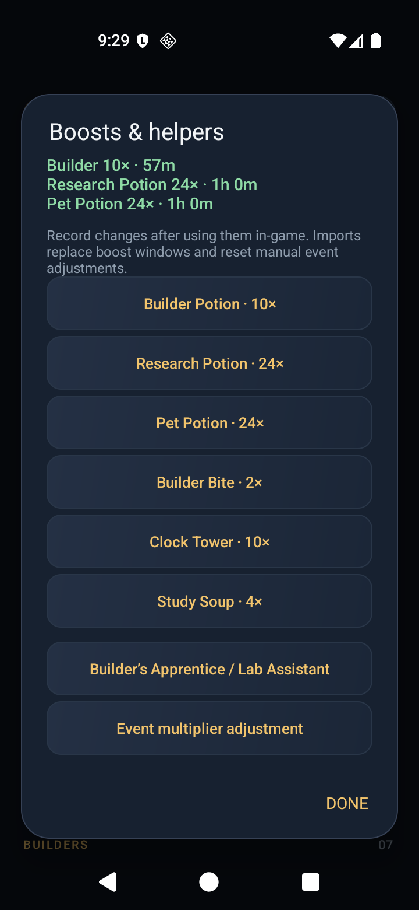
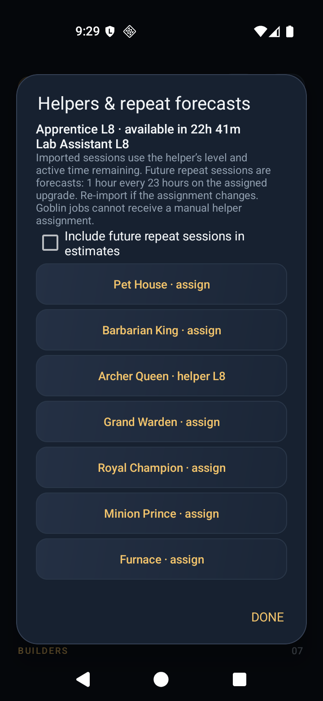
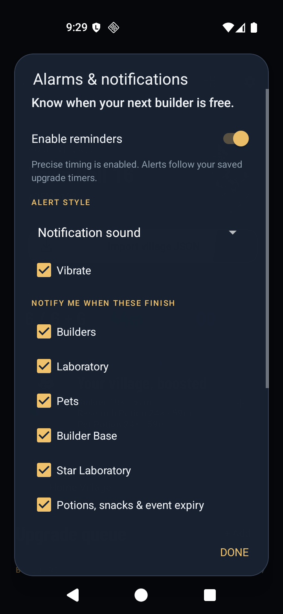

# Clash Ledger

Keep an eye on your Clash of Clans upgrades from your Android home screen. See when your next builder is free, follow research and pet upgrades, and get a reminder when they finish.

**[Download for Android](https://github.com/chitti-a7r4/coc-tracker/releases/latest)** · [Getting started](#getting-started) · [Screenshots](#screenshots) · [Common questions](#common-questions)

Free and open source. Works offline on **Android 8.0 or newer**. No account, ads, or tracking.

## Download and install

1. Open the **[latest release](https://github.com/chitti-a7r4/coc-tracker/releases/latest)** on your Android phone.
2. Expand **Assets** and download the file ending in **`.apk`**, such as `app-debug.apk`.
3. Open the downloaded file and tap **Install**. If Android asks, allow your browser or file manager to install apps.

You can install directly on your phone—Android Studio and a computer are not required. Choose the APK rather than the source-code ZIP.

**Updating?** From v1.3.0, the app checks automatically at most once per day when opened and shows an **Update available** button if a newer stable release includes an APK. You can also use **Settings → Check for updates → Check now**. Open the newer APK and tap **Update**. Installing a compatible update over the existing app keeps your saved village and settings. Uninstalling or clearing app storage removes them.

Check the release notes for the features included in each download. The source code in this repository may contain changes that have not been published as an APK yet.

## Getting started

### 1. Import your village

In Clash of Clans, open **Settings → More Settings → Data Export** and copy your village data.

In Clash Ledger:

1. Tap the gold **Import village JSON** button.
2. Tap **Paste from clipboard**.
3. Tap **Preview import**, check the details, then tap **Import village**.

JSON is simply the text export supplied by the game; you do not need to edit it. You can also use **Choose file** to open a saved export, or **Share → Clash Ledger** from an app holding the exported text or file.

You can keep **multiple villages** on the same device. An import updates the village with the matching player tag, or adds a new one. Other villages are kept. Reusing the same export does not restart timers or add duplicate accounts.

Tap **Switch village** on the overview card, or open **Settings → Switch / manage villages**. Each village keeps its own timers, potions, helpers and event adjustments. All widgets follow the selected village. With two or more saved villages, tap the **⇄ switch button beside refresh** on either widget layout to cycle through accounts directly on your home screen—no need to open the app. Reminders continue for all saved villages and include the village name; tapping one opens that village.

Use **Manage villages** to remove a saved village or add an empty one for manual tracking. Removing a local village does not change anything in the game. Your existing village is migrated automatically when updating from earlier versions.

If an export includes a `name`, it is used for a new village. Standard exports often contain only the player tag; use **Village settings** to name those accounts. Your custom name is preserved on later imports.

### 2. Add the home screen widget

Tap the **four-square widget icon** at the top of the app and accept your phone's prompt. You can also long-press an empty area on your home screen, open **Widgets**, and choose **Clash Ledger**.

Resize the widget to fit your home screen. The default **detailed list** scrolls to show every upgrade. Tap a row to open the app, or tap refresh to update the display from your saved timers.

Prefer a smaller tile? Open **Settings → Appearance & widget layout → Compact icon-grid widget**. Each upgrade gets its game icon, a progress ring and one countdown. The grid does not scroll; it fits whole tiles to the widget size and shows **+N more** when space runs out. Ongoing upgrades come first. Tap an icon to edit that timer, or tap the footer to open the full queue. Resize the widget to show more icons.

The compact layout preference applies to all Clash Ledger widgets. Rings refresh with the widget; Clock countdowns tick between refreshes.

### 3. Choose your countdown style

Open the **gear icon → Countdown format**.

| Format | Example | Best for |
| --- | --- | --- |
| Days / hours / minutes | `1d 3h 6m` | A compact overview |
| Friendly wording | `1 day 3 hr 6 min` | Easy-to-read time labels |
| Clock | `27:05:12` | Watching the seconds count down |

**Clock always shows seconds.** Every upgrade has one countdown, with the same format choice used by the app and widget. The first two formats round up to the next minute and refresh with the widget; Clock ticks continuously while visible.

### 4. Choose a theme

Open **Settings → Appearance & widget layout** and enable **Pure black · OLED** for black app and widget backgrounds. Borders, text and progress remain visible. Turn it off to return to the original navy theme.

### 5. Check the next research slot

The overview’s third summary card is now **Next lab**, replacing the old Ready count. It shows the normal Laboratory slot’s next completion, including boosts and helpers. On the Builder Base tab it follows the **Star Laboratory**. Temporary Goblin research is tracked separately and does not make the normal lab look occupied.

## New in 1.3.0

All changes since 1.2.1 are included in this release:

- **Crafted defenses:** import nested module timers, including inherited Goblin flags. Update the app and re-import to pick up timers omitted by older versions.
- **Forge / Auto Forge:** manual Capital Gold timers, artwork, widgets and reminders. Regular Forge shares Home Village builders and uses Builder Potion speedups. Auto Forge uses neither. Manual Forge timers are kept on re-import; review them after changes in-game.
- **Goblin slots:** add/edit Goblin builder or Laboratory jobs separately from normal slots.
- **Builder Base fixes:** builder count and Next free now follow the selected village tab. Shared building names use village-specific artwork; Builder Bite and other boosts have their own icons.
- **Custom alerts:** choose a ringtone or audio file and receive upgrade reminders 0–1440 minutes before completion. Early alerts replace completion alerts; boost expiry alerts stay at expiry.
- **Safer paste:** large exports display a short **Export loaded** summary while preserving the full JSON for Preview import. **Clear export** removes it.
- **Optional clipboard suggestions:** enable **Settings → Import & update preferences → Suggest clipboard exports when I open the app**. Valid exports offer **Review / Dismiss**. Matching uses the player tag; imported duplicates are skipped, older snapshots are warned about, and dismissed snapshots are remembered (up to 64). Nothing changes until you tap **Import village**.
- **Automatic update notices:** enabled by default, with a switch in the same preferences screen. Checks GitHub at most once per day when opened and shows **Update available** for a newer stable release with an uploaded APK. **Settings → Check for updates** remains available.
- **Village names:** import a name when present without replacing an existing custom name. Standard exports often contain only a tag.
- **Local crash diagnostics:** **Settings → Crash diagnostics** lets you copy the latest Java crash report. Exports, player tags and exception messages are excluded; sharing is your choice.

Forge automatic import still needs a verified export containing an active Forge job. Builder Bite effects on Forge are not assumed. Enable Forge reminder categories if updating with an existing category selection.

If the app closes unexpectedly, reopen it and use **Settings → Crash diagnostics → Copy report** to share a local diagnostic report. See [validation and known limits](docs/VALIDATION.md).

[Full release notes](docs/RELEASE_1.3.0.md) · [Future tracking proposal](docs/TRACKING_PROPOSAL.md)

## Added in 1.2.0–1.2.1

Compact progress-ring widgets, OLED black theme, next-research summary, multiple saved villages with direct widget switching, and Guardian artwork for **Logger, Longshot and Smasher**. Additional spell and trap icons include Totem Spell and Giga Bomb. Existing Town Hall 18, Revenge Tower, Super Wizard Tower and Greedy Raven artwork remains available.

<table><tr>
<td align="center">OLED dashboard</td>
<td align="center">Compact widget</td>
<td align="center">Village switching</td>
</tr></table>

[See the compact widget after resizing](docs/screenshots/compact-widget-small.png).

## Screenshots

Detailed-list screenshots from **v1.1.2** on the Android emulator, using demo village data. The widget shows Clock format with one countdown per upgrade. Tap an image to view it full size.

<table>
  <tr>
    <td align="center"><a href="docs/screenshots/dashboard.png"></a><br>Village dashboard</td>
    <td align="center"><a href="docs/screenshots/widget.png"></a><br>Home screen widget</td>
    <td align="center"><a href="docs/screenshots/upgrades.png"></a><br>Upgrade queue</td>
  </tr>
  <tr>
    <td align="center"><a href="docs/screenshots/boosts.png"></a><br>Boosts &amp; events</td>
    <td align="center"><a href="docs/screenshots/helpers.png"></a><br>Helpers &amp; forecasts</td>
    <td align="center"><a href="docs/screenshots/reminders.png"></a><br>Alarms &amp; notifications</td>
  </tr>
</table>

## What you can track

- Home Village builders, heroes, crafted-defense modules, laboratory research, and pets.
- Builder Base upgrades and Star Laboratory research.
- Goblin builder and researcher jobs alongside your normal slots.
- Supported potions, snacks, helper assignments, and manual event adjustments.
- Remaining time, target levels, finish dates, and builder availability.

Use the **Home Village** and **Builder Base** tabs to switch queues and their next-builder / next-lab summaries. Tap an upgrade to edit it, enter zero remaining time to mark it ready, or long-press it to remove its local timer. Use **+ Add** for a manual upgrade.

For manual entries, enter the remaining work at normal speed, before temporary potion speedups. Fresh imports are the easiest way to keep your timers accurate.

## Potions, helpers, and events

Open the **gear icon → Boosts & helpers**, or tap the purple boost card.

Use a potion or snack **in Clash of Clans first**, then import a fresh export or record it in Clash Ledger. Recording an item here updates the estimate; it does not activate anything in the game. You can adjust the minutes remaining or enter zero to end a tracked boost.

| Boost | What the app tracks |
| --- | --- |
| Builder Potion | 10× Home Village builder speed |
| Research Potion | 24× Laboratory speed |
| Pet Potion | 24× pet upgrade speed |
| Builder Bite | 2× builder speed; Builder Potion takes priority while both are active |
| Clock Tower | 10× Builder Base construction and Star Laboratory speed |
| Study Soup | 4× lab/pet speed on its own; 27× alongside a Research/Pet Potion |

**Pet Potion import is still being verified.** If an active Pet Potion is missing after import, record its remaining time manually.

### Builder’s Apprentice and Lab Assistant

Active assignments are imported when the export includes their level and remaining work session. Open **Builder’s Apprentice / Lab Assistant** to review or correct an assignment.

**Include future repeat sessions in estimates** is optional and starts off. Enable it to forecast repeat work on the same upgrade. These future sessions are estimates—import again if you change the helper's assignment in-game. Other helper types are not currently modeled.

### Event adjustments

Use **Event multiplier adjustment** only when you need an extra speed adjustment for a selected upgrade category.

An exported timer may already include Hammer Jam, Gold Pass, or another discount. Leave the adjustment at **1×** when that reduction is already included, so it is not counted twice. A fresh import resets manual event adjustments.

## Alarms and notifications

Open the **gear icon → Alarms & notifications**, then turn on **Enable reminders**.

- Choose **quiet notifications**, **notification sound**, or an **alarm tone**.
- Choose vibration and which upgrade categories or boost expiries should alert you.
- Allow notifications if Android asks.
- Use **Precise alarm timing** to allow more timely alerts. Without it, Android may delay delivery.
- Tap **Choose custom reminder sound** to select a ringtone/alarm sound, pick an audio file, or return to the system default. Notification and alarm modes keep separate choices. Keep custom audio files available on your phone.
- Tap **Alert at completion** (or the existing early-alert value) to choose **0–1440 minutes early**. For example, enter 5 for an alert five minutes before an upgrade finishes. This applies across saved villages; boost expiry reminders still fire at expiry.
- Use **Test reminder in 10 seconds** to try the selected sound. Precise timing permission is needed for a reliable ten-second test. **Sound & notification settings** opens Android’s channel settings.

An alarm repeats until you stop it, or stops automatically after one minute. Android volume and Do Not Disturb settings still apply.

Reminders are based on your saved timers. Upgrades already completed or already inside the chosen early-alert window when you import or enable reminders do not trigger retroactive alerts. An early alert replaces the completion alert; it does not ring twice.

## Common questions

### Will my village update automatically?

Countdowns keep running after import, including when the app is closed. Optional clipboard suggestions can offer a fresh export when you open Clash Ledger; they always require review and confirmation. **New actions in the game need a fresh export or a manual edit**—for example, starting an upgrade, using a book, activating a potion, or moving a helper.

A player tag alone cannot fetch these active timers through the [official Clash of Clans API](https://developer.clashofclans.com/). The widget's refresh button recalculates your saved timers; it does not fetch new data from the game.

### Why does the widget look a little out of date?

Android can delay widget refreshes to save battery. Day/hour/minute labels, progress bars, and boost labels may temporarily lag behind. Tap refresh or open the app to update them. Clock format continues ticking between refreshes, but may briefly run below zero before a completed row refreshes to **Ready**.

### Why did a reminder arrive late or not arrive?

Check that reminders and Android notification permissions are enabled. For more accurate timing, allow **Precise alarm timing**. Battery restrictions can still affect delivery. If you force-stop the app or change its alarm permission, open it again to restore scheduling.

### Does this work with every Town Hall?

Imports have automated coverage for Town Hall levels **1–18**, and the app has been checked with a real TH16 village. Testing across every village layout, game update, phone, and launcher is still ongoing. Unrecognized items keep their timers with a placeholder name that you can edit.

### Is my village data uploaded?

No. Exports are read and stored on your device. The internet permission is used for GitHub app-update checks (automatic daily checks while opening the app, unless disabled, and manual checks); it sends no village export, player tag, or saved settings. Tracking works offline. There is no game login, advertising, or analytics. Clearing app storage or uninstalling removes your saved data.

### How can I report a problem?

[Open an issue](https://github.com/chitti-a7r4/coc-tracker/issues) with your app version, Android version, what happened, and what you expected. Screenshots help. If you share an export, remove any details you do not want to publish.

## For developers

<details>
<summary>Build the APK, run checks, and contribute</summary>

Use **JDK 17 or 21**, Android SDK platform **36**, and Android SDK Build Tools. Set `ANDROID_HOME` to your SDK directory, or let Android Studio create `local.properties`.

From the project folder:

```sh
./gradlew :app:assembleDebug
```

The installable APK is written to:

```text
app/build/outputs/apk/debug/app-debug.apk
```

`UP-TO-DATE` means the existing APK already matches the source, so its timestamp may stay unchanged. Building does not install the APK on your phone. Install it manually or use:

```sh
adb install -r app/build/outputs/apk/debug/app-debug.apk
```

Run the checks before opening a pull request:

```sh
./gradlew :app:testDebugUnitTest :app:lintDebug
```

On Windows, use `gradlew.bat`. The project uses Gradle 8.13, Android Gradle Plugin 8.13.2, and Java 17 source compatibility. Release builds need your own signing configuration; keep signing keys out of the repository. Updates must use the same signing key as the installed app.

There are **92 unit tests** covering timer calculations, imports, boosts, helper forecasts, countdown formats, reminder planning, account migration/isolation, research summaries and compact-widget sizing. See [validation notes and known limits](docs/VALIDATION.md) for the scope of testing. Contributions for real-device testing, export compatibility, accessibility, and timer accuracy are welcome.

</details>

## License and credits

App source code is licensed under **MIT**. See [LICENSE](LICENSE) and [NOTICE](NOTICE).

Clash of Clans artwork and characters belong to **Supercell** and are not covered by the app's MIT license. Artwork is sourced through ClashKingAssets; the app uses Barlow Condensed under the SIL Open Font License. See [artwork and font credits](docs/ARTWORK.md).

This material is unofficial and is not endorsed by Supercell. For more information, see [Supercell's Fan Content Policy](https://supercell.com/en/fan-content-policy/).
